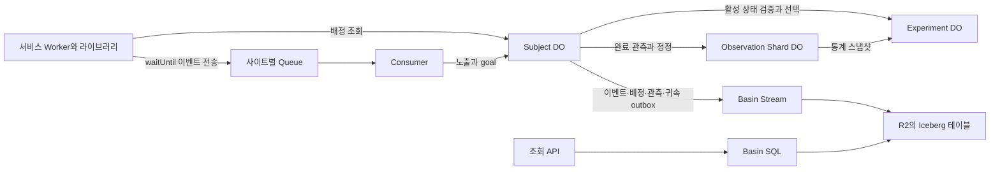

# 웹로그 분석과 지속형 MAB 기술 설계

[확정 요구사항](DESIGN.md)을 구현하기 위한 1차 설계다. 아래 기본값은 설계자가 선택한 시작값이며 운영 데이터에 따른 조정 대상이다. SDK·로컬 런타임·분석 API·설치 구성이 구현되어 있으며 실제 Cloudflare 리소스 배포 검증은 남아 있다. 현재 증거와 미완료 항목은 [구현 상태](docs/IMPLEMENTATION.md)를 따른다. 알고리즘 실험은 [시뮬레이션 결과](docs/SIMULATION.md)에 별도로 기록한다.

## 구성과 책임

하나의 npm 패키지에서 서비스 Worker용 함수, Durable Object 클래스, Queue consumer 구성 함수를 제공한다. 설치 도구가 이용자의 Cloudflare 계정에 리소스와 바인딩 설정을 생성하는 형태를 목표로 한다. 외부 운영 SaaS나 별도의 브라우저 SDK는 필요하지 않다. 기존 Worker의 fetch·queue 처리와 함께 사용할 수 있도록 핸들러를 조합하고, 설치 과정은 생성할 리소스와 설정 변경을 먼저 출력한다.



| 구성 | 책임과 저장 범위 |
| --- | --- |
| 서비스 Worker 함수 | 외부에서 받은 이벤트 검증, cid 쿠키 처리 보조, uid 공급받기, 배정 요청, 비동기 전송 |
| Identity Registry DO | cid의 익명 구간과 uid의 고정 상태 위치. 신규 uid가 익명 상태 전체를 인계받아 가입 보상을 잃지 않도록 라우팅 |
| Subject DO | 사이트 내 uid 또는 익명 cid별 배정, 마지막 노출, 관측 구간, 최근 이벤트 중복 처리, 보상 귀속 |
| Experiment DO | 실험별 arm 운영 상태, 합산 감쇠 통계, 선택과 pending 예약, 정책 버전 |
| Observation Shard DO | 완료 관측 revision 원장과 감쇠 통계. 실험별 subject hash로 16개에 분산 |
| Site Control DO | 사이트별 goal 정의와 상태 변경 시각, 실험 목록. 관리와 배치 설정 조회에 사용 |
| Queue와 consumer | 이벤트 배치 전달, 실패 재시도, 각 이벤트 종류에 맞는 처리 대상으로 라우팅 |
| Basin Pipelines·Catalog·SQL와 R2 | 원시 이벤트와 분석용 파생 레코드를 저장하고 임의 조건 분석 수행 |

DO는 SQLite backend를 사용한다. 사용자와 실험이 각각 일관성을 유지하는 단위이며, 전체 원시 로그를 하나의 DO에 넣지 않는다. DO의 객체별 저장소는 트랜잭션과 강한 일관성을 제공한다. [DO 저장소](https://developers.cloudflare.com/durable-objects/best-practices/access-durable-objects-storage/)

초기에는 KV를 필수 구성에서 제외한다. arm 중지 직후 배정 조회의 의미를 지키기 위해 활성 arm 여부는 Experiment DO에서 확인한다. 설정의 최종 일관성 캐시로 이를 대신하지 않는다. [KV 일관성](https://developers.cloudflare.com/kv/concepts/how-kv-works/)

## 서비스 연동 API

다음은 API 계약의 개요다. 실행 가능한 연동 예제는 [호스트 예제](examples/host.ts), 분석 요청·응답은 [분석 계약](docs/ANALYTICS.md)을 따른다.

```typescript
const eye = createEye({ service: env.EYE, ctx, siteId });
const subject = { cid, uid }; // uid는 서비스의 인증 결과

const decision = await eye.decide({ subject, experimentId });
// 서비스가 arm을 실제 적용한 시점에 호출
if (decision.status === 'assigned') eye.expose({ subject, decision, occurredAt, userAttributes });
eye.track({ subject, eventId, name, occurredAt, attributes });
eye.goal({ subject, eventId, goalId, occurredAt, value, attributes });
```

`decide`는 배정 일관성 때문에 비동기 RPC 응답을 기다린다. 로그 함수는 로컬 검증과 큐 등록 예약 후 반환하고 전송 완료를 요청 응답에서 기다리지 않는다. 서비스가 다른 경로로 이벤트를 수집했으면 그 경로에서 같은 함수들을 호출한다. `expose`는 DOM 가시성을 라이브러리가 판정한다는 뜻이 아니라 서비스가 실제 적용 사실을 알려주는 계약이다.

관리 API는 goal 등록·중지·재개·삭제, 실험 등록, arm 추가·중지·재개, 정책 설정 변경을 제공한다. 조회 API는 실험 결과, 세그먼트 비교, 시계열, 사용자 타임라인, 속성 목록을 제공한다. 기본 배포 경계는 서버 측 함수다. HTTP로 노출할 때의 사용자 인증·권한 검사는 호스트 서비스가 담당한다. Cloudflare 토큰은 서버에만 둔다.

호스트에 별도 HTTP 공개 엔드포인트를 강제하지 않는다. consumer와 DO 클래스는 호스트 Worker에 통합하거나 패키지에서 제공하는 보조 Worker로 배포할 수 있게 하고, v1 설치 템플릿은 보조 Worker와 Service Binding을 사용하는 한 경로로 단순화한다.

## 식별과 배정

`subjectKey`는 사이트와 `uid:` 또는 `cid:` 접두사를 포함한다. uid가 없으면 cid의 현재 익명 구간, 있으면 uid에 고정된 상태 위치가 배정의 기준이다. 논리 식별자와 물리 Subject DO 위치는 분리한다. 신규 uid가 cid 상태 전체를 인계받을 때 관측과 노출을 복제하거나 초기화하지 않으며, 이후 익명 트래픽은 새 구간으로 보낸다. 쿠키를 재설정한 익명 브라우저는 새로운 대상으로 취급한다.

로그인 시 서비스가 cid와 uid를 함께 전달한다. uid에 유효한 배정이 있으면 그것을 사용한다. uid에 배정이 없고 현재 cid의 배정이 유효하면 해당 배정을 인계해 전환을 줄인다. 충돌하는 익명 관측은 전환 시점에 interrupted로 표시한다. 이미 완료된 익명 표본을 소급해서 다른 arm의 표본으로 바꾸지 않는다.

cid와 uid의 연결에는 시각과 로그인 구간을 기록한다. 공유 브라우저의 모든 과거·미래 기록을 한 uid에 영구 연결하지 않는다. 로그아웃·계정 전환은 서비스가 알려주며 익명 배정 구간을 새로 시작한다. 원시 이벤트의 당시 cid·uid는 수정하지 않고, 타임라인에서 확인된 연결 구간만 합쳐 보여준다.

배정 조회는 Subject DO의 현재 배정과 Experiment DO의 현재 활성 상태를 확인한다. 신규 선택은 Experiment DO에서 직렬화하고, reservation ID와 정책 버전을 반환한다. Subject DO는 자신의 revision을 확인한 뒤 배정을 저장한다. RPC를 기다리는 동안 다른 요청이 먼저 배정을 저장했으면 그 배정을 채택하고 불필요해진 reservation을 해제한다. DO 사이의 작업이 원자적 트랜잭션인 것처럼 취급하지 않는다.

arm 중지 관리 호출이 완료된 **후 시작한** 배정 조회는 그 arm을 반환하지 않는다. 중지와 동시에 진행 중이던 응답이나 이미 그려진 화면까지 회수한다는 의미는 아니다. 모든 arm이 중지되면 `no_active_arm`을 반환한다. RPC 실패 시에는 호스트가 기본 동작을 선택할 수 있도록 `unavailable`을 반환하며, 오래된 arm을 정상 MAB 배정인 것처럼 반환하지 않는다.

로그 전송의 비동기화는 배정 RPC 비용을 없애지 않는다. 이 비용은 실제 지역별 측정이 필요하다. 매 요청에 배정 조회가 불필요한 서비스는 실제 변형을 결정하는 지점에서만 호출한다.

## 관측 구간과 재배정

실험별 `observationWindow`를 둔다. 기본 제안은 7일이며 각 arm에 같은 값을 적용한다. 한 표본은 **한 사용자와 한 실험의 한 관측 구간**이다. API는 고유 사용자 수와 관측 구간 수를 구별한다. 재방문 사용자는 장기간에 걸쳐 여러 표본을 만들 수 있으므로 서로 독립인 신규 사용자 수로 표시하지 않는다.

1. 배정만으로 표본을 만들지 않는다. 해당 배정의 첫 `expose` 시각을 `start`로 하고 `[start, start + W)`를 연다.
2. 같은 arm의 반복 노출은 마지막 노출 시각만 바꾼다. 관측 종료 시각을 계속 연장하지 않는다.
3. 일반 재배정은 `max(assignedAt + minHold, start + W)` 이후의 다음 `decide`에서 허용한다.
4. 관측이 끝났는데 서비스가 다시 노출하지 않으면 새 표본을 자동 생성하지 않는다. 기존 arm을 유지하더라도 다음 실제 노출 시 새 구간을 연다.
5. uid 통합·arm 중지는 즉시 전환을 허용한다. 종료 전 강제 전환된 구간은 `interrupted`로 남기고 완료 표본의 평균에는 넣지 않는다. 새 arm의 실제 노출부터 새 W 구간을 시작한다.
6. 기간 전체를 관측하고 goal이 없었던 구간은 0 보상이다. 진행 중인 구간과 interrupted 구간을 0으로 채우지 않는다.

**관측 기간은 학습의 유한한 평가 범위다.** 구간 종료 뒤 실제 발생한 goal도 사이트 합계와 마지막 노출 기준 귀속 원장에는 남는다. 다만 해당 과거 구간의 W일 보상에는 더하지 않는다. `outside_observation`으로 반환해 UI에서 학습에 쓰이지 않은 보상도 확인할 수 있게 한다. 이전 방문의 goal도 W 안에 발생하면 동일하게 포함한다. W가 짧으면 늦은 가치가 학습에서 빠지므로 구매 주기에 맞춰 설정해야 한다.

노출은 구간 밖에서도 보상 귀속을 위한 마지막 시각으로 남을 수 있다. 귀속 규칙과 학습 표본의 기간을 혼동하지 않는다. 이 구분은 동일 길이의 사용자 성과를 비교한다는 요구사항을 구현하기 위한 선택이다.

## 보상 귀속과 지연 이벤트

시각 t에 발생한 goal에 대해 t 이전에 노출 이력이 있는 실험 집합을 E(t), 그 수를 K라고 한다. 각 실험의 마지막 노출 시각을 t_e, 해당 실험의 귀속 반감기를 A_e로 둔다.

```text
base(e)   = goal.value / K
credit(e) = base(e) * 2^(-(t - t_e) / A_e)
```

같은 실험의 여러 노출은 K를 늘리지 않는다. 귀속 대상이 없으면 사이트 합계만 갱신한다. 음수에도 같은 계수를 곱한다. 감쇠로 줄어든 몫, interrupted나 구간 밖이라 학습에 쓰이지 않은 몫을 다른 실험으로 돌리지 않는다.

arm이 중지되었더라도 중지 전 실제 노출은 과거 귀속 원장에서 사라지지 않는다. 이후 새 arm의 노출이 있으면 그 시점부터 새 arm이 마지막 노출이다. 오래된 실험의 감쇠가 작아졌다는 이유로 K에서 조용히 빼면 다른 실험의 몫이 커지므로 그런 최적화는 하지 않는다. Subject DO의 실험별 마지막 노출 메타데이터는 원시 로그 60일 보존과 분리한다. 실험 수가 늘수록 균등 분배 자체가 보상 척도를 바꾸는 효과는 분석 데이터에 K를 함께 기록해 확인한다.

발생 시각과 수신 시각을 모두 저장한다. consumer가 역순으로 받은 노출을 처리할 때 최신 도착 항목으로 덮어쓰지 않고 발생 시각순 이력에 삽입한다. 늦은 노출은 그 시각부터 다음 노출 전까지의 goal에 영향을 주므로 해당 구간의 귀속과 관측 합계를 재계산한다. 사이트 goal 합계 자체는 다시 더하지 않는다.

기본 `allowedLateness`는 1시간이다. 관측 종료 + L 이후 한 번 완료 처리하고, 이후에도 최근 60일 범위의 늦은 이벤트가 도착하면 revision을 올려 정정한다. L은 처음 완료하는 지연이지 늦은 이벤트를 모두 버리는 선이 아니다. 이미 완료된 표본의 y가 바뀌면 표본 수를 추가하지 않고 합계·제곱합만 변경한다. 변경의 학습 가중치는 **원래 구간 종료 시각** 기준이며 도착 시각 기준으로 새 보상처럼 만들지 않는다.

60일보다 오래된 발생 시각의 이벤트와 정정은 v1 지원 범위 밖이라는 결과를 반환한다. 진행 중 관측은 60일 안에 종료되도록 `W + L <= 60일`을 검증한다. 귀속 반감기와 학습 상태가 60일에 리셋되는 것은 아니다.

goal의 중지·삭제는 발생 시각 당시 운영 상태로 판정한다. 이전 발생 이벤트가 늦게 도착한 경우에도 활성 구간에 해당하면 반영한다. 재개하면 재개 이후 발생한 이벤트부터 다시 반영한다. 삭제된 ID는 다른 goal의 ID로 재사용하지 않는다.

## 시간 감쇠를 적용한 낙관적 선택

이 규칙의 이름은 `discounted-empirical-ucb-v1`로 둔다. 검증된 확률적 신뢰상한이라는 의미의 UCB가 아니라, **최근 평균에 불확실성 보너스를 더하는 실용적인 선택 점수**다. 알려진 상·하한이 없는 보상에 유계 보상 UCB1의 보장을 주장하지 않는다. 큰 보상도 원래 단위로 보존한다. [discounted UCB 연구](https://arxiv.org/abs/0805.3415), [heavy-tailed bandit 연구](https://arxiv.org/abs/1209.1727)

arm별로 완료 표본의 감쇠 가중치 합 N, 보상 합 S, 제곱합 Q와 마지막 갱신 시각을 둔다. 학습 반감기 H는 기본 14일이다. 시간 Δ가 지나면 세 값에 모두 `d = 2^(-Δ/H)`를 곱한다. 주기적인 전체 스캔 대신 읽거나 갱신할 때 감쇠를 적용한다.

```text
w_i = 2^(-(now - observationEnd_i) / H)
N = Σ w_i
S = Σ w_i * y_i
Q = Σ w_i * y_i²
mean = S / N
variance = max(0, Q / N - mean²)
```

실제 구현은 큰 수의 차감 오차와 제곱 오버플로를 줄이도록 공통 배율과 가중 중심 모멘트를 사용한다. 위 식은 의미를 정의하는 식이다. 수치 범위를 벗어난 입력·합계는 오류로 드러내고 조용히 클리핑하지 않는다. 값에 제한이 없다는 요구는 모든 실수를 컴퓨터에서 무한 정밀도로 표현한다는 의미는 아니다.

활성 arm 전체의 완료 표본에서 pooled mean과 pooled 표준편차를 계산한다. `rewardScale`은 관측이 없거나 분산이 0일 때의 초기 단위 척도이며 기본 1이다. 운영자가 가치 단위에 맞게 바꿀 수 있다. 이는 보상 상한이 아니다.

```text
scale       = max(rewardScale, pooledStdDev)
armScale    = max(armStdDev, 0.25 * scale)
mean(a)     = S_a / N_a                 # 데이터 없음: pooled mean, 전체 없음: 0
variance(a) = Q_a / N_a - mean(a)²      # 데이터 없음: scale²
mass        = Σ_active (N_a + P_a)
score(a)    = mean(a) + c * armScale * sqrt(log(2 + mass) / (max(N_a, 1) + η P_a))
```

`c=2`, `η=1`을 시작값으로 둔다. P는 현재 유효한 예약과 관측 중인 구간 수다. P는 이미 배정된 트래픽의 압력만 표현하고 N·S·Q에 포함하지 않는다. P를 더한 점수를 통계적 신뢰구간으로 표시하지 않는다. `N² / Σw²`만 표본 수로 쓰면 시간이 지나 모든 가중치가 함께 작아져도 값이 유지되므로, 망각에 따른 재탐색을 그 값에만 의존하지 않는다.

선택은 다음 순서로 한다.

1. 활성 arm에 신규 배정 트래픽의 총 2%를 균등 무작위 배정한다. arm별 하한은 `0.02 / 활성 arm 수`다.
2. 나머지에서 `N < 8`이고 `P < 8`인 arm이 있으면 `N + P`가 가장 작은 arm을 선택한다. 동률은 무작위다.
3. 그렇지 않으면 score가 가장 큰 arm을 선택하고 동률은 무작위로 푼다.

정책의 선택 확률은 이 혼합 규칙과 동률 집합으로 정확히 계산해 배정 이벤트에 남긴다. 표본이 적다는 이유로 무제한 높은 점수를 주어 관측 지연 동안 모든 트래픽이 신규 arm에 몰리는 것을 P로 완화한다. 기존 배정을 유지하는 요청에는 이 선택 규칙을 다시 적용하지 않는다.

reservation은 idempotent ID를 가지며 첫 노출 전 기본 5분 만료를 둔다. 실제 노출이 확인되면 관측 종료까지 pending으로 전환한다. 늦은 노출은 만료된 예약의 pending을 되살릴 때 중복 카운트하지 않는다. 완료·중지·전환 시 P를 한 번만 감소시킨다. 원격 호출 후 응답을 잃어도 재시도가 새 예약을 만들지 않게 한다.

같은 배정을 유지한 채 두 번째 관측 구간을 열 때도 새 observation ID로 pending을 등록한다. 기존 배정 조회 횟수나 반복 노출 횟수를 P에 더하지 않는다.

### 설정의 의미

| 설정 | 시작값 | 바꾸는 대상 |
| --- | --- | --- |
| minHold | 실험 등록 시 지정 | 같은 arm을 최소 유지하는 시간 |
| observationWindow | 7일 | 사용자 한 표본의 평가 기간 |
| attributionHalfLife | 1일 | 마지막 노출과 goal 사이 간격에 따른 보상 감쇠 |
| learningHalfLife | 14일 | 오래된 완료 표본을 잊는 속도 |
| allowedLateness | 1시간 | 관측 구간의 최초 완료를 기다리는 여유 |
| explorationFloor | 총 2% | 신규 배정의 지속적 탐색 |
| rewardScale | 1 가치 단위 | 데이터가 적을 때 보너스의 단위 척도 |

학습 반감기와 귀속 반감기는 독립적이다. 기존 관측에는 시작 시점의 설정 버전을 고정한다. 관측 기간·보상 계산 설정을 바꾸면 새 학습 세대를 시작해 서로 다른 의미의 표본을 같은 통계에 섞지 않는다. 기존 학습 상태와 이력은 조회용으로 보존한다. arm 추가·중지는 학습 세대를 초기화하지 않는다.

## 전달과 집계의 일관성

요청마다 이벤트를 한꺼번에 묶어 Queue에 보낸다. SDK는 isolate 메모리에만 쌓아 두고 다음 요청을 기다리는 버퍼를 사용하지 않는다. `ctx.waitUntil()`의 요청 후 실행 제한과 Queue 수신 전 소량 유실은 확정된 허용 범위다. Queue 수신 뒤에는 기본 재시도를 사용하고, 중복 메시지를 보상에 다시 더하지 않는다. [Workers Context](https://developers.cloudflare.com/workers/runtime-apis/context/), [Queue 전달 보장](https://developers.cloudflare.com/queues/reference/delivery-guarantees/)

같은 논리 이벤트를 재시도할 때는 동일한 event ID, subject 정보와 payload를 사용한다. uid가 나중에 확인되었다는 이유로 같은 goal을 다른 subject의 새 이벤트로 다시 보내지 않는다. 연결 정보는 별도의 identify 이벤트로 전달한다.

Subject DO는 이벤트 중복 확인, 노출·관측 변경, 내보낼 레코드를 한 로컬 트랜잭션으로 기록한다. 같은 DO 안의 outbox에는 미전송 변경만 보관한다. 원격 RPC나 Stream 전송 성공을 확인하고 지우며, 응답 유실로 재전송해도 받는 쪽이 ID·revision으로 같은 변경임을 알아야 한다. 별도의 범용 워크플로 시스템을 추가하지 않는다.

관측 갱신은 `{observationId, revision, endAt, armId, status, reward}` 전체 스냅샷으로 보낸다. Observation Shard DO는 더 높은 revision만 적용한다. 이전 완료 값 y_old가 새 완료 값 y_new가 되면 동일한 w로 S에 `w*(y_new-y_old)`, Q에 `w*(y_new²-y_old²)`를 반영하고 N은 유지한다. pending→complete는 N을 한 번 더하고, complete→interrupted 정정은 기존 가중 기여를 한 번 뺀다. 오래된 revision이 뒤늦게 도착하면 무시한다.

정정·중복 처리 원장을 단일 Experiment DO에 60일치 쌓지 않는다. 실험별 16개 Observation Shard DO에 subject hash로 나누고, 보관 기한이 끝난 관측의 원장 행은 지워도 이미 합산한 감쇠 통계는 유지한다. 각 shard는 변경을 게시하고 실패 시 alarm으로 재시도하며 `{shardId, sequence, asOf, armMoments}` 전체 통계를 Experiment DO에 보낸다. 수신자는 최신 sequence의 기여분만 유지하고 조회 시각으로 감쇠한 뒤 합산한다. 모든 이벤트 수보다 실험별 고정된 shard 수에 비례하는 통계를 배정 경로에서 읽는다.

짧은 pending 예약은 Experiment DO에만 두고 관측 기간의 pending 원장은 Observation Shard에 분산한다. shard의 절대 통계 스냅샷이 관측 pending과 예약 해제를 함께 전달한다. pending 예약과 관측 완료 통계는 서로 다른 역할이다. 완료나 중단 통보는 reservation ID로 한 번 반영하고, 통계 스냅샷이 아직 도착하지 않았으면 N 반영이 잠시 늦을 수 있다. 이 지연은 정책 버전의 `statsAsOf`로 드러낸다. 이미 끝난 관측의 결과를 기다리는 동안 pending을 완료 보상 0으로 바꾸지 않는다.

Subject DO는 가장 가까운 관측 마감·outbox 재시도만 alarm으로 예약한다. 하나의 alarm에서 도래한 작업을 함께 처리한다. 유휴 사용자마다 짧은 주기의 timer를 돌리지 않는다. alarm의 중복 실행도 같은 ID·revision으로 처리한다. [DO alarms](https://developers.cloudflare.com/durable-objects/api/alarms/)

## 분석 저장소와 조회 계획

초기 분석 저장소는 **Basin Pipelines → R2의 Parquet/Iceberg → Basin Catalog → Basin SQL**로 정한다. 임의 속성에 따른 그룹·조건 조회를 구현하기 위해 사용자별 DO를 순회하거나 모든 원본을 Worker 메모리로 읽지 않는다. 온라인 학습은 이 테이블 반영을 기다리지 않는다.

Catalog sink는 Parquet을 사용하며 파일 반영 간격의 문서상 기본값은 300초, 최소값은 60초다. 초기 설정은 60초를 사용하되 실제 데이터 가시성의 상한으로 약속하지 않는다. 분석 API는 데이터 반영 시각을 반환한다. [Catalog sink](https://developers.cloudflare.com/basin-pipelines/sinks/available-sinks/r2-data-catalog/)

| 테이블 | 기본 키와 주요 필드 | 사용 |
| --- | --- | --- |
| events | event_id, occurred_at, received_at, kind, processing_status, cid, uid, subject_key, experiment_id, arm_id, goal_id, value, attributes_json | 원래 로그와 타임라인 |
| observations | observation_id, revision, generation, experiment_id, arm_id, start_at, end_at, status, reward, subject_attributes_json, interrupt_reason | 0 보상까지 포함한 비교 분모와 결과 |
| credits | goal_event_id, experiment_id, revision, exposure_id, assignment_id, observation_id, K, base_value, decay_factor, credit, learning_eligible | 개별 보상 설명과 실험별 합계 |
| decisions | decision_id, reservation_id, subject_key, experiment_id, arm_id, occurred_at, policy_version, probability, reason | 신규·유지·강제 전환 및 배분 정책 추적 |
| identity_links | link_id, cid, uid, linked_from, linked_until | 확인된 기기·로그인 구간의 타임라인 연결 |

모든 테이블에 사이트, 스키마 버전, 레코드의 안정적인 ID와 처리 시각을 둔다. 원래 cid·uid와 별도로 물리 상태 소유자를 나타내는 state_key를 두어 인계 전후 이벤트와 관측을 연결한다. JSON 속성의 키는 서비스가 정하고 값은 문자열·유한 수·불리언·null을 지원한다. 비교 연산의 타입이 맞지 않으면 쿼리 입력 오류로 돌려준다. 이벤트 당시 속성과 관측 시작 당시 사용자 속성을 별도로 보존한다.

중지·삭제 상태 때문에 무시한 goal은 타임라인에 그 이유를 남길 수 있지만, 사이트 value와 학습 집계에는 `processing_status=accepted`인 goal만 포함한다.

Stream 전송 전에 런타임 스키마를 검증한다. 현재 문서에서 구조화 Stream의 잘못된 레코드는 수신 후 유실될 수 있다고 명시하므로 TypeScript 타입만으로 이를 대신하지 않는다. [Stream 쓰기](https://developers.cloudflare.com/basin-pipelines/streams/writing-to-streams/)

Pipelines sink의 전달 보장이 생산자의 동일 이벤트 재전송까지 제거해 주는 것은 아니다. 내보내기 레코드는 재시도해도 내용이 같게 고정하고, 조회는 같은 ID·revision의 중복을 제거한 뒤 최신 revision을 선택한다. **상태가 complete인 행만 먼저 필터링하면 이후 interrupted revision을 놓치므로 최신 revision 선택 후 상태를 필터링한다.** 원시 이벤트도 event_id 기준으로 중복을 제거해 사이트 합계와 타임라인을 반환한다.

### 세그먼트와 성과

기본 성과 조회는 관측 시작 시점의 사용자 속성으로 cohort를 만든다. cohort의 모든 완료 관측을 분모로 하고, 그 관측에 귀속된 보상을 합산한다. 특정 goal의 값을 보고 싶어도 그 goal을 달성한 사용자만 분모에 남기지 않는다. `hasEvent` 조건은 먼저 관측 ID 집합을 만든 뒤 관측 테이블과 연결하며 이벤트 수에 따라 분모가 늘어나는 JOIN을 피한다.

구간 시작일을 기준으로 cohort 기간을 선택하고 응답에 `cohortBasis=observation_start`를 명시한다. 발생일별 사이트 value와 구간별 arm 성과는 별도 metric이다. 관측 기간 W, 미완료·interrupted 수, 관측당 평균, 고유 사용자 수, 정책의 감쇠 평균을 각각 반환한다. 임의의 세그먼트 평균은 실험의 학습 목표를 변경하지 않는다.

MAB의 시간에 따른 배정 변화와 임의의 사후 세그먼트 분류 때문에, 관측된 평균 차이를 바로 인과적 uplift나 p-value로 반환하지 않는다. 신규 배정의 확률과 동시 실험 노출 이력을 제공해 이후 검증에 사용할 수 있게 한다. 초기에는 실험별 독립 선택과 동일한 귀속 규칙을 사용하며 실험 조합 전체를 하나의 arm으로 최적화하지 않는다.

### 요청과 응답

분석 API는 구조화된 filter AST를 받는다. 기간은 최근 60일 안에서 필수이고, groupBy는 초기 최대 3개, limit은 최대 1,000행으로 둔다. 이 숫자는 제품의 의미가 아닌 쿼리 비용을 통제하기 위한 변경 가능한 시작값이다. 사용자에게 SQL 조각을 직접 받지 않는다. 식별자는 허용된 스키마에서 선택하고, 값은 SQL literal로 안전하게 컴파일한다.

```json
{
  "experimentId": "checkout-layout",
  "from": 1790812800000,
  "to": 1792022400000,
  "filter": { "and": [
    { "field": { "key": "country", "type": "string" }, "op": "eq", "value": "KR" },
    { "field": { "key": "accountAgeDays", "type": "number" }, "op": "lt", "value": 30 }
  ] },
  "groupBy": [{ "key": "plan", "type": "string" }]
}
```

Basin SQL은 JOIN·CTE·JSON 함수·집계·window 함수를 지원한다. 리소스가 큰 쿼리는 거절되거나 시간이 초과될 수 있으므로, 최신 revision 제거에도 먼저 실험·시간 범위 필터를 적용하고 `EXPLAIN`으로 읽기 범위를 확인한다. 기본은 정확한 수치이며 근사 고유 사용자 수를 사용하면 응답에 이를 명시한다. [SQL 지원 범위와 제약](https://developers.cloudflare.com/basin-sql/reference/limitations-best-practices/)

타임라인은 해당 subject 또는 확인된 cid·uid 연결 구간과 occurred_at으로 범위를 제한하고 `(occurred_at, table_name, record_id)` 커서를 사용한다. 첫 페이지의 수신 시각 상한을 커서에 넣어 이후 새로 수신한 이벤트를 제외한다. 다만 이미 수신했지만 테이블에 늦게 반영되는 이벤트까지 고정하는 snapshot은 아니다. 그런 이벤트를 포함해 다시 보려면 조회를 새로 시작한다.

응답에는 결과 행별 `latestReceivedAt`과 `meta.consistency=eventual`, 조회 시각과 수신 시각 상한을 제공한다. 마지막으로 보이는 시각을 그 이전의 모든 이벤트가 반영되었다는 watermark로 표현하지 않는다. 정책의 `statsAsOf`도 분석 테이블의 완전성을 보장하지 않는다.

조회 Worker는 Basin SQL HTTP API를 호출하며 토큰을 서버 secret으로 관리한다. 초기에는 결과를 기다리는 단일 조회 API로 제공한다. 제한을 넘는 요청은 명시적인 오류와 더 좁은 범위를 제안하고, 60일 이전 비동기 분석 기능을 추가하지 않는다. [Basin SQL 조회 API](https://developers.cloudflare.com/basin-sql/query-data/)

기본 데이터 반영 목표는 수 분 이내다. 실험별 최근 성과 요약이 더 빨리 필요하면 `getPolicy`가 Experiment DO의 현재 통계와 갱신 시각을 반환한다. 이 값과 분석 테이블의 집계 기준·시각을 같은 값인 것처럼 섞지 않는다.

### 60일과 실제 저장량

하루 100만 이벤트라면 최근 60일 원본은 최대 약 6천만 행이다. 파생 credit·decision·observation 행은 여기에 추가된다. 원본 한 건을 1 KiB로 가정하면 원본만 약 60 GB이고, 이 수치는 압축 전 용량 가정이지 요금 추정이 아니다. 속성 수·동시 실험 수·반복 배정에 따라 실제 저장·스캔량이 달라진다.

Basin SQL은 압축된 데이터의 스캔량에 따라 과금한다. 기간·실험·subject 필터와 열 선택, 동일 조회의 짧은 캐시를 우선 적용하고 별도 OLTP 인덱스를 초기부터 추가하지 않는다. 관리형 sink가 만든 실제 partition spec과 Parquet 통계를 확인해 predicate pushdown을 검증한다. 지원 여부를 확인하지 않은 사용자 hash partition 설정을 설치 옵션으로 약속하지 않는다. [Basin SQL 과금 기준](https://developers.cloudflare.com/basin-sql/platform/pricing/)

조회 API의 60일 범위는 물리 삭제 정책과 다르다. 60일 이전 데이터의 정책은 사용자가 미뤘으므로 자동 삭제·장기 백업을 이번 설계에서 추가하지 않는다. 따라서 실제 저장량은 조회 범위보다 커질 수 있다. Catalog snapshot expiration이 현재 테이블의 60일 이전 행을 지워주는 것으로 해석하지 않는다. Iceberg 데이터 파일에 R2 수명 주기 삭제를 무작정 적용하지 않는다. [Catalog 데이터 삭제](https://developers.cloudflare.com/basin-catalog/deleting-data/)

## 검증 상태와 구현 순서

| 단계 | 이번에 한 일 | 남은 검증 |
| --- | --- | --- |
| 알고리즘 | Python으로 540일·8개 시드·8개 시나리오 비교, 반감기 민감도 추가 실행 | 실제 재방문·강제 전환·동시 실험 상호작용을 포함한 이벤트 수준 시뮬레이션 |
| 수치와 규칙 | 양수·음수 감쇠, 정정 시 표본 수 유지, pending 처리, 단위 배율 검산 | 큰 수의 안정적 모멘트 구현, 무한 정밀도가 아닌 숫자 표현의 경계 |
| Cloudflare | 현재 공식 API·저장·조회 제약 확인과 구성 설계 | 실제 리소스 배포, 오류·재시도 통합 검사, 지역별 지연·비용 측정 |
| 분석 | 테이블·revision·cohort·타임라인 계약 정의 | 실제 6천만 행의 EXPLAIN·스캔량·지연 확인 |

순수 계산, DO·Queue 연결, Basin 내보내기·조회 compiler·설치 도구의 로컬 구현이 진행되었다. 현재 코드의 검증 증거와 미완료 식별 경계는 [구현 상태](docs/IMPLEMENTATION.md)를 따른다. 아래 대규모·원격 측정은 아직 수행하지 않았다.

배포 후 부하 검증은 1,000만·6천만 원본 행, 서로 다른 크기의 속성, 1개·10개 동시 실험을 포함한다. 입력 12건/초의 평상시 부하와 120건/초 10분 burst를 시작 기준으로 삼고, 배정 RPC의 지역별 p50·p95·p99, Queue 지연, 학습 반영 지연, 조회 지연, 스캔 byte를 측정한다. 12건/초는 일평균을 근사한 값이고 실제 최대치 약속이 아니다.

분석의 초기 성능 목표는 대표적인 60일 arm 집계와 제한된 사용자 타임라인 p95 5초 이내다. 목표를 넘으면 실제 조회 계획에 따라 partition·집계 테이블 또는 사용자 이력 인덱스를 선택한다. 이 문서의 설계만으로 그 지연이나 하루 100만 건의 운영 비용을 검증했다고 주장하지 않는다.
